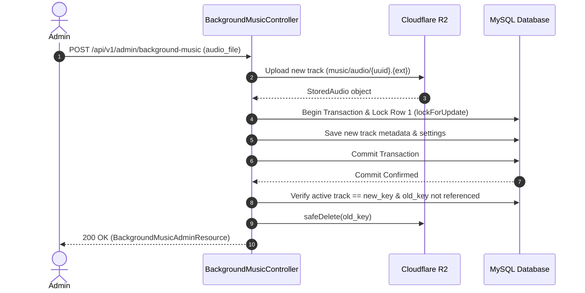

# Waai Media — Background Music API Documentation

This document describes the API contract, architecture, and Postman testing guide for the **Background Music Module** of the Waai Media backend platform (Laravel 13 API backend, Angular Admin Dashboard, and Angular Public Website).

The Background Music module manages public playback configuration and administrative track uploads/replacements via Cloudflare R2 object storage.

---

## 1. Module Overview & Core Architecture

### 1.1 Singleton Settings Pattern
- **One Logical Record:** The platform stores at most one Background Music record with `id = 1`.
- **Initial Unconfigured State:** When unconfigured, the public `GET` endpoint returns `HTTP 200 OK` with `{"data": {"is_enabled": false, "is_loop": false, "audio_url": null}}`.
- **Track Management (PUT/POST):** The admin endpoint accepts multipart form-data to update playback switches (`is_enabled`, `is_loop`) and optionally upload/replace the audio track (`audio_file`).
- **Partial Updates Supported:** Either `is_enabled` or `is_loop` can be updated without uploading an audio file. The existing audio track is preserved.

### 1.2 Storage & File Safeguards
- **R2 Storage Disk:** All audio files are stored on Cloudflare R2 (`'r2'`).
- **Path Format:** `music/audio/{uuid-v4}.{ext}`.
- **Maximum File Size:** 15 MiB (15,728,640 bytes).
- **Supported Audio Formats:** All valid audio formats supported by the application and storage engine (including MP3, WAV, OGG, M4A, AAC, FLAC, OPUS, AIFF, WMA, MIDI, AU, WebM audio, etc.).
- **Detection & Security Strategy:** Deep MIME and magic buffer inspection (`finfo`) coupled with HTTP upload MIME rules (`audio/*`, `application/ogg`, `application/x-ogg`, `application/vnd.apple.mpegurl`). Non-audio files renamed to audio extensions are strictly rejected (`422 Unprocessable Content`).

---

## 2. Cloudflare R2 Security & Credential Isolation

### Strict Credential Protection
1. **Zero Frontend Exposure:**
   - Under no circumstances are `CLOUDFLARE_R2_ACCESS_KEY_ID` or `CLOUDFLARE_R2_SECRET_ACCESS_KEY` delivered to clients.
   - API endpoints, controllers, and resources return only the resolved public delivery URL (`audio_url` or `file_url`).
   - Internal storage keys (`music/audio/{uuid}.{ext}`), bucket names, and private S3 endpoints are excluded from public responses.
2. **Safe URL Delivery:**
   - `AudioStorageService::getUrl()` constructs public URLs exclusively from `config('filesystems.disks.r2.url')` concatenated with the validated relative key.
   - Query parameters, signature keys, and authentication headers are never appended to delivery URLs.
3. **Log Sanitization:**
   - Full disk configuration arrays are never logged.
   - In incident logs (such as commit ambiguity or rollback failure), only the relative object keys (`new_key`, `old_key`) and error messages are recorded.

---

## 3. Authorization & Security

| Role | Public Read (`GET /api/v1/background-music`) | Admin Read (`GET /api/v1/admin/background-music`) | Admin Update (`PUT/POST /api/v1/admin/background-music`) |
| :--- | :---: | :---: | :---: |
| **Public / Guest (Unauthenticated)** | `200 OK` | `401 Unauthorized` | `401 Unauthorized` |
| **Admin** (`role: admin`) | `200 OK` | `200 OK` | `200 OK` |
| **Editor** (`role: editor`) | `200 OK` | `200 OK` | `200 OK` |
| **Viewer** (`role: viewer`) | `200 OK` | `403 Forbidden` | `403 Forbidden` |
| **Other / Custom Roles** | `200 OK` | `403 Forbidden` | `403 Forbidden` |

### Security Middleware Stack (Admin)
1. `auth:sanctum`: Requires a valid Sanctum Bearer token in the `Authorization` header.
2. `require.access`: Enforces that only Access Tokens with the `access` ability are accepted.
3. `role:admin,editor`: Ensures the authenticated user possesses an administrative role (`admin` or `editor`).

---

## 4. Endpoints Summary

All routes are prefixed with `/api/v1`.

| Method | Endpoint | Access Level | Description |
| :--- | :--- | :--- | :--- |
| `GET` | `/api/v1/background-music` | Public (Unauthenticated) | Returns public playback configuration and streaming URL. |
| `GET` | `/api/v1/admin/background-music` | Admin, Editor | Returns full track metadata, file size, MIME type, and toggles. |
| `PUT\|PATCH\|POST` | `/api/v1/admin/background-music` | Admin, Editor | Updates toggles or uploads/replaces audio file via `multipart/form-data`. |

---

## 5. Detailed Endpoint Contracts

### 5.1 Public Playback Endpoint

- **Route:** `GET /api/v1/background-music`
- **Middleware:** None (Public, unauthenticated)
- **Headers:** `Accept: application/json`

#### Response: Unconfigured / No Track
```http
HTTP/1.1 200 OK
Content-Type: application/json

{
    "data": {
        "is_enabled": false,
        "is_loop": false,
        "audio_url": null
    }
}
```

#### Response: Configured Track
```http
HTTP/1.1 200 OK
Content-Type: application/json

{
    "data": {
        "is_enabled": true,
        "is_loop": true,
        "audio_url": "https://pub-example.r2.dev/music/audio/3c1d4590-781b-4f93-8ec2-1fa93036a142.mp3"
    }
}
```

*Note: Internal fields (`id`, `file_name`, `file_size`, `mime_type`, `file_path`, R2 credentials) are strictly excluded from public output.*

---

### 5.2 Admin Management Endpoints

#### 1. Retrieve Current Settings & Metadata
- **Route:** `GET /api/v1/admin/background-music`
- **Headers:**
  - `Accept: application/json`
  - `Authorization: Bearer {{admin_token}}`

```http
HTTP/1.1 200 OK
Content-Type: application/json

{
    "data": {
        "id": 1,
        "has_track": true,
        "file_name": "ambient_soundtrack.mp3",
        "file_url": "https://pub-example.r2.dev/music/audio/3c1d4590-781b-4f93-8ec2-1fa93036a142.mp3",
        "file_size": 2490368,
        "mime_type": "audio/mpeg",
        "is_enabled": true,
        "is_loop": true,
        "updated_at": "2026-10-25T12:00:00.000000Z"
    }
}
```

#### 2. Update Settings or Replace Audio Track
- **Route:** `PUT|PATCH|POST /api/v1/admin/background-music`
- **Content-Type:** `multipart/form-data` (Do **not** set manually in Postman; let Postman generate the boundary).
- **Form-Data Parameters:**

| Field Name | Type | Required | Description |
| :--- | :--- | :---: | :--- |
| `audio_file` | File | No (`nullable`) | Audio file up to 15 MiB (15,728,640 bytes). Any valid audio container/format (MP3, WAV, OGG, M4A, AAC, FLAC, OPUS, AIFF, WMA, etc.) is accepted. Non-audio files are rejected. |
| `is_enabled` | Boolean / String | No (`nullable`) | JSON boolean `true`/`false`, or form-data string `"true"`/`"false"` / `"1"`/`"0"`. Arbitrary strings (e.g. `"hello"`, `"yesplease"`, `""`) are rejected with `422`. Toggles playback on public site. |
| `is_loop` | Boolean / String | No (`nullable`) | JSON boolean `true`/`false`, or form-data string `"true"`/`"false"` / `"1"`/`"0"`. Arbitrary strings (e.g. `"hello"`, `"yesplease"`, `""`) are rejected with `422`. Toggles continuous looping. |

```http
HTTP/1.1 200 OK
Content-Type: application/json

{
    "success": true,
    "message": "Background music updated successfully.",
    "data": {
        "id": 1,
        "has_track": true,
        "file_name": "ambient_soundtrack.mp3",
        "file_url": "https://pub-example.r2.dev/music/audio/3c1d4590-781b-4f93-8ec2-1fa93036a142.mp3",
        "file_size": 2490368,
        "mime_type": "audio/mpeg",
        "is_enabled": true,
        "is_loop": true,
        "updated_at": "2026-10-25T12:00:00.000000Z"
    }
}
```

---

## 6. Replacement Lifecycle & Concurrency Protection



### Safety Guarantees
1. **Pessimistic Row Locking:** `lockForUpdate()` prevents race conditions between concurrent administrative requests.
2. **Post-Commit Deletion:** Old tracks are deleted **only** after `DB::commit()` succeeds and a subsequent query confirms the database references the new key.
3. **Commit Ambiguity (Zero Deletions):** If an exception occurs during the commit phase (`$txPhase === 'COMMITTING'`), all files are preserved in R2, and a critical incident is logged.
4. **Pre-Commit Rollback:** If persistence fails before commit and rollback succeeds, the uncommitted new object is cleaned up via `safeDelete()`.
5. **Deletion Failure Resilience:** If R2 deletion of the old track fails post-commit, a warning is logged, the active track remains intact, and HTTP 200 is returned.

---

## 7. Weekly Orphan Cleanup Command (`music:clean-orphaned`)

```powershell
# Manual Dry-Run (Default - No files are deleted)
php artisan music:clean-orphaned

# Manual Destructive Execution
php artisan music:clean-orphaned --force

# Custom Grace Period
php artisan music:clean-orphaned --force --grace-hours=48
```

### Safety Rules
- **Prefix Isolation:** Scans only objects under `music/audio/`.
- **Key Validation:** Rejects malformed keys, path traversals (`..`), and non-UUID formats.
- **Active & Referenced Object Protection:** Excludes the current active track (`Music::find(1)->file_path`) and all non-null `file_path` values in the database.
- **Grace Period (24 Hours):** Objects uploaded within the last 24 hours are skipped to avoid races with concurrent uploads.
- **JIT Database Revalidation:** Re-checks database references immediately before deleting each candidate.
- **Fail-Closed Behavior:** If the database or R2 listing fails, the command exits with code `1` and makes zero deletions.
- **Timestamps:** Age comes from the R2 object's last-modified time. Missing, unreadable, zero or future timestamps keep the object.
- **Empty-Reference Guard (single-record adaptation):** A destructive run aborts (exit `1`, zero deletions) when no track is recorded in the database but audio objects exist, which usually means the wrong or an empty database. Review with `--dry-run`, then pass `--allow-empty-references` if the deletion is genuinely intended (for example before the first track was ever activated).
- **Max-Deletions Guard:** With a single active track a healthy week leaves only a handful of orphans, so the default cap is `--max-deletions=5`. If more objects are eligible, nothing is deleted (exit `1`).
- **Overlap Protection:** An atomic cache lock (`music:clean-orphaned`) stops manual and scheduled runs from overlapping; the second run exits `1` without touching storage. The lock is released even after a failed run.
- **Flags:** `--dry-run` takes precedence over `--force`; without `--force` the command is always a dry run.
### Scheduler Configuration
In `routes/console.php`:
```php
Schedule::command('music:clean-orphaned --force --grace-hours=24 --max-deletions=5')
    ->weeklyOn(1, '03:00') // Every Monday at 03:00 AM
    ->withoutOverlapping(120)
    ->runInBackground();
```

The weekly job deletes objects (`--force`). Prerequisites before relying on it in production:
1. A cron entry running `php artisan schedule:run` every minute.
2. A cache store that supports atomic locks (with `CACHE_STORE=database`, the `cache_locks` table must exist).
3. Run `php artisan music:clean-orphaned --dry-run` once and review the candidates.
4. Remember the grace period is the only protection for the window between an R2 upload and its database commit; keep it at 24 hours or more.

---

## 8. Postman Collection & Localhost Testing Guide

The collection is located at:
`docs/Waai_Media_Background_Music_API.postman_collection.json`

### 8.1 Collection Variables

| Variable Name | Default Value | Description |
| :--- | :--- | :--- |
| `base_url` | `http://127.0.0.1:8000` | Local Laravel API host address. Default points to local `php artisan serve`. |
| `token` | `""` | Active Bearer token for general requests. |
| `admin_token` | `""` | Sanctum access token for a user with `role: admin` and `access` ability. |
| `editor_token` | `""` | Sanctum access token for a user with `role: editor` and `access` ability. |
| `viewer_token` | `""` | Sanctum access token for a user with `role: viewer` (tests `403 Forbidden`). |
| `invalid_token` | `invalid_or_revoked_token_placeholder` | Malformed or revoked token string (tests `401 Unauthorized`). |

### 8.2 Quick Setup Steps

1. **Import the Collection:**
   - In Postman, click **Import** and select `docs/Waai_Media_Background_Music_API.postman_collection.json`.
2. **Start Local Laravel Server:**
   ```powershell
   php artisan serve --port=8000
   ```
3. **Obtain Tokens:**
   - Authenticate via `POST /api/v1/auth/login` using your local admin credentials (`admin@waaimedia.test`) and copy the returned `access_token` into `admin_token`.
   - Authenticate with an editor account (`editor@waaimedia.test` or `editor1@gmail.com`) and copy the token into `editor_token`.
   - Optionally authenticate with a viewer account to populate `viewer_token`.
4. **Select Local Audio Fixtures in Postman:**
   - For requests in folder **4. Admin Audio Upload & Safe Replacement**:
     - `4.1 Upload First Track (Valid MP3)`: In the **Body** tab, click `audio_file` and choose a small `.mp3` file.
     - `4.2 Replace Audio Track (Valid WAV)`: Choose a small `.wav` file.
     - `4.3 Replace Audio Track (Valid OGG)`: Choose a small `.ogg` file.
     - `4.4 Replace Audio Track (Valid M4A)`: Choose a small `.m4a` file.
     - `4.5 Replace Audio Track (Valid AAC)`: Choose a small `.aac` file.
     - `4.6 Replace Audio Track (Valid FLAC)`: Choose a small `.flac` file.
   - For folder **5. Validation & Rejection Scenarios**:
     - `5.1 Rejection - Fake Non-Audio File Renamed to Audio Extension`: Select a text or script file renamed to `.mp3` (rejected with `422`).
     - `5.2 Rejection - Oversized Audio File`: Select any audio file > 15 MiB (rejected with `422`).
     - `5.3 Rejection - Unsupported File Extension or MIME`: Select any `.pdf`, `.png`, or `.txt` file (rejected with `422`).
5. **Run the Collection:**
   - Execute requests individually or click **Run Collection** in Postman to execute the full suite in sequence.

---

## 9. Automated Test Suite & Verification Results

All tests run against isolated test database `waai_media_testing` guarded by `TestDatabaseSafetyGuardTest`.

| Test Suite | Command | Tests | Assertions | Result |
|---|---|:---:|:---:|:---:|
| **Database Safety Guard** | `php artisan test --filter=TestDatabaseSafetyGuardTest` | 10 | 21 | **PASSED** |
| **Background Music API** | `php artisan test --filter=BackgroundMusicApiTest --compact` | 23 | 117 | **PASSED** |
| **Orphan Cleanup Command** | `php artisan test --filter=CleanOrphanedBackgroundMusicCommandTest --compact` | 8 | 20 | **PASSED** |
| **Code Style (Pint)** | `vendor/bin/pint --test` | — | — | **PASSED** |

