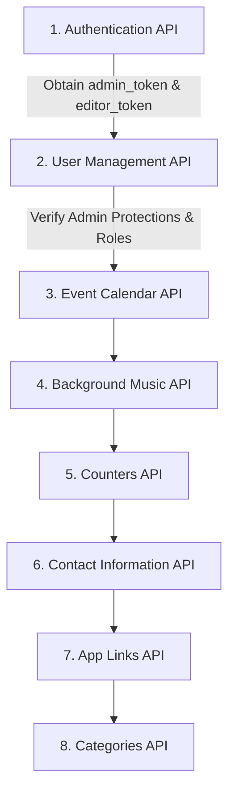

# Waai Media — Local API Testing & Postman Verification Guide

This guide describes how to run and test the Waai Media backend API locally using Postman and the provided collections.

---

## 1. Safety Rules & Constraints

> [!IMPORTANT]
> **Strict Safety Notice:**
> - Never run migrations or tests against production servers.
> - No endpoints or test sequences contain destructive drop/truncate commands.
> - The News module has been completely retired. Do not import or test any `/api/v1/news` endpoints.
> - All tests assume local testing on `http://127.0.0.1:8000`.

---

## 2. Local Setup & Prerequisites

### 2.1 Requirements
- **PHP**: 8.2 or higher (Running PHP 8.5)
- **Composer**: Latest version
- **Database**: Local SQLite or MySQL / PostgreSQL
- **Postman**: Postman Desktop app or Web client (v10+)

### 2.2 Local Environment Setup (`.env`)
Ensure your local `.env` has the following minimum variables set:
```ini
APP_NAME="Waai Media"
APP_ENV=local
APP_KEY=base64:your_app_key_here
APP_DEBUG=true
APP_URL=http://127.0.0.1:8000

DB_CONNECTION=sqlite
# Or MySQL:
# DB_CONNECTION=mysql
# DB_HOST=127.0.0.1
# DB_PORT=3306
# DB_DATABASE=waai_media_local
# DB_USERNAME=root
# DB_PASSWORD=

SESSION_DRIVER=database
SANCTUM_STATEFUL_DOMAINS=127.0.0.1:8000,localhost:4200
```

### 2.3 Initialize the Local Database
Run non-destructive migrations locally to create the required schema:
```bash
php artisan migrate
```

To populate the system with the initial first administrator account and default counters:
```bash
php artisan db:seed
```
*(By default, `DatabaseSeeder` provisions the initial administrator and default counter records).*

### 2.4 Start the Local Web Server
Start the local Laravel development server:
```bash
php artisan serve --port=8000
```
The API is now reachable at `http://127.0.0.1:8000/api/v1`.

---

## 3. Importing Postman Collections & Environment

All Postman files are located in the `docs/` directory:

| File | Purpose |
|:---|:---|
| [`docs/Waai_Media_Local.postman_environment.json`](file:///c:/Projects/Waai_media/docs/Waai_Media_Local.postman_environment.json) | Local environment variables (`base_url`, `admin_token`, `editor_token`, etc.) |
| [`docs/Waai_Media_Authentication_API.postman_collection.json`](file:///c:/Projects/Waai_media/docs/Waai_Media_Authentication_API.postman_collection.json) | Authentication, sessions, OTP, password recovery, CSRF |
| [`docs/Waai_Media_User_Management_API.postman_collection.json`](file:///c:/Projects/Waai_media/docs/Waai_Media_User_Management_API.postman_collection.json) | User management, roles, admin password resets, admin protections |
| [`docs/Waai_Media_Counters_API.postman_collection.json`](file:///c:/Projects/Waai_media/docs/Waai_Media_Counters_API.postman_collection.json) | Fixed system metrics (Public & Admin updates) |
| [`docs/Waai_Media_Contact_Info_API.postman_collection.json`](file:///c:/Projects/Waai_media/docs/Waai_Media_Contact_Info_API.postman_collection.json) | Contact coordinates (Social, address, phones, emails) |
| [`docs/Waai_Media_App_Links_API.postman_collection.json`](file:///c:/Projects/Waai_media/docs/Waai_Media_App_Links_API.postman_collection.json) | Mobile app download URLs |
| [`docs/Waai_Media_Categories_API.postman_collection.json`](file:///c:/Projects/Waai_media/docs/Waai_Media_Categories_API.postman_collection.json) | Multilingual category taxonomy (Blogs, Portfolio, News) |
| [`docs/Waai_Media_Background_Music_API.postman_collection.json`](file:///c:/Projects/Waai_media/docs/Waai_Media_Background_Music_API.postman_collection.json) | Audio playback track configuration & uploads |
| [`docs/event-calendar/final/event-calendar.postman_collection.json`](file:///c:/Projects/Waai_media/docs/event-calendar/final/event-calendar.postman_collection.json) | Event calendar, scheduling, publishing |

### Import Instructions:
1. Open **Postman**.
2. Click **Import** (top left).
3. Select or drag-and-drop the `.json` files from the `docs/` folder.
4. Set your active environment to **"Waai Media - Local Environment"** in the top right environment dropdown.

---

## 4. Recommended Testing Sequence

Because protected routes require authentication and specific user roles, test the modules in the following order:



### Step 1: Authentication API
1. Run **CSRF Token Bootstrap** (`GET /api/v1/auth/csrf-token`) to obtain session cookies.
2. Run **Login Admin** (`POST /api/v1/auth/login`) with `admin@waaimedia.com`.
   - The test script will automatically set the `admin_token` environment variable.
3. Run **Login Editor** (`POST /api/v1/auth/login`) with `editor@waaimedia.com` (or create one in Step 2).
   - Set the `editor_token` environment variable.
4. Run **Current User Profile** (`GET /api/v1/auth/me`) with `Authorization: Bearer {{admin_token}}` to verify token validity.

### Step 2: User Management API
1. Run **1.1 List Users** to view all users in the system.
2. Run **2.1 Create Editor Account** to provision a test editor.
3. Run **3.1 Update Editor Profile** to verify profile updates.
4. Run **3.2 Change User Role** to test role transitions.
5. Run **4.1 Admin Reset Editor Password** to verify admin password management.
6. Run **5.2 Editor Forbidden** using `editor_token` to confirm editors receive 403.
7. Run **5.5 Delete First Admin Ever Created** to verify the permanent first-admin deletion guard (403).

### Step 3: Event Calendar API
1. Run **Public Events Listing** (`GET /api/v1/events`).
2. Run **Create Event** (`POST /api/v1/admin/events`) as Admin.
3. Run **Publish Event** (`POST /api/v1/admin/events/{id}/publish`).
4. Run **Unpublish Event** (`POST /api/v1/admin/events/{id}/unpublish`).
5. Run **Delete Event** (`DELETE /api/v1/admin/events/{id}`).

### Step 4: Background Music API
1. Run **Get Public Background Music** (`GET /api/v1/background-music`).
2. Run **Get Admin Background Music** (`GET /api/v1/admin/background-music`).
3. Run **Update Track Details** (`POST /api/v1/admin/background-music`) with multipart form-data.
   *(See Section 5 for local file upload testing).*

### Step 5: Counters API
1. Run **Get Public Counters** (`GET /api/v1/counters`) to inspect all 5 predefined counters.
2. Run **Batch Update Counters** (`PUT /api/v1/admin/counters`) to test updating metrics.

### Step 6: Contact Information API
1. Run **Get Public Contact Info** (`GET /api/v1/contact-info`).
2. Run **Update Contact Info** (`PUT /api/v1/admin/contact-info`).

### Step 7: App Links API
1. Run **Get App Links** (`GET /api/v1/app-links`).
2. Run **Update App Links** (`PUT /api/v1/app-links`).

### Step 8: Categories API
1. Run **News Categories** (`GET /api/v1/categories?type=news`).
2. Run **Blogs Categories** (`GET /api/v1/categories?type=blogs`).
3. Run **Portfolio Categories** (`GET /api/v1/categories?type=portfolio`).
*(Supports `Accept-Language: ar` and `Accept-Language: en`).*

---

## 5. Local File Uploads & Cloudflare R2 Storage

Endpoints supporting file uploads:
- `POST /api/v1/admin/background-music` (Music file upload: `audio/mpeg`, max 10MB).
- `POST /api/v1/admin/events` / `PUT /api/v1/admin/events/{id}` (Event cover image: `image/jpeg,png,webp`, max 5MB).

### Testing File Uploads in Postman:
1. In the request **Body** tab, choose **form-data**.
2. For the file key (e.g. `file` or `cover_image`), hover over the key input and select **File** from the dropdown.
3. Click **Select Files** and choose a valid sample file from your local machine.

### Storage Driver Configuration (`FILESYSTEM_DISK`):
- For local testing without external dependencies, set:
  ```ini
  FILESYSTEM_DISK=public
  ```
  and run:
  ```bash
  php artisan storage:link
  ```
- If testing with Cloudflare R2:
  ```ini
  FILESYSTEM_DISK=r2
  R2_ACCESS_KEY_ID=your_key
  R2_SECRET_ACCESS_KEY=your_secret
  R2_BUCKET=your_bucket
  R2_URL=https://your-public-r2-url.com
  R2_ENDPOINT=https://your-account-id.r2.cloudflarestorage.com
  ```

---

## 6. Endpoints Requiring Manual Runtime Verification

The following endpoints interact with third-party external services or specific client environments and should be manually verified during end-to-end testing:

1. **Email Delivery / Password OTP (`POST /api/v1/auth/forgot-password`)**:
   - Sends real 4-digit OTP via queued email.
   - For local testing, configure `MAIL_MAILER=log` in `.env` and verify the OTP from `storage/logs/laravel.log`.
2. **Cloudflare R2 Object Storage**:
   - Uploading large MP3 or image files to verify upload signatures and CDN delivery when `FILESYSTEM_DISK=r2`.
3. **Double-Submit CSRF & SameSite Cookies**:
   - In Postman, ensure "Automatically follow redirects" and cookie jar storage are enabled to test browser-like cookie rotation on `POST /api/v1/auth/refresh`.
